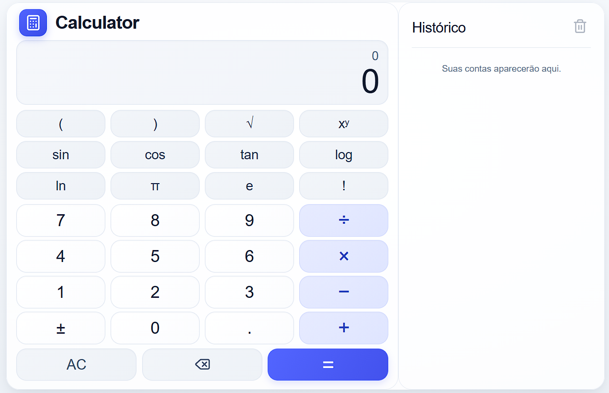

# Calculator

Uma calculadora científica responsiva desenvolvida com Next.js, React e TypeScript. Ela oferece operações aritméticas básicas, funções científicas, entrada pelo teclado e histórico de cálculos salvo no navegador.



## Recursos

- Funções científicas: raízes quadradas, potências, trigonometria, logaritmos, fatoriais, π e o número de Euler.
- Avaliação de expressões com mathjs e respeito à precedência matemática dos operadores.
- Suporte ao teclado físico e teclas adequadas para telas sensíveis ao toque.
- Histórico de cálculos com opção de reutilizar expressões e resultados, excluir itens individualmente e limpar tudo após confirmação.
- O histórico fica salvo no `localStorage` do navegador; não é necessário criar uma conta e nenhum serviço remoto é usado.
- As funções trigonométricas usam radianos. Não há modo de graus.
- Interface clara e responsiva para computadores e dispositivos móveis.

## Tecnologias

- Next.js App Router
- React e TypeScript
- Tailwind CSS 4
- mathjs
- Vitest
- lucide-react

## Requisitos

- Node.js 20 ou superior
- npm

## Instalação e execução

```bash
npm install
npm run dev
```

## Testes

```bash
npm test
```

## Compilação para produção

```bash
npm run build
```
